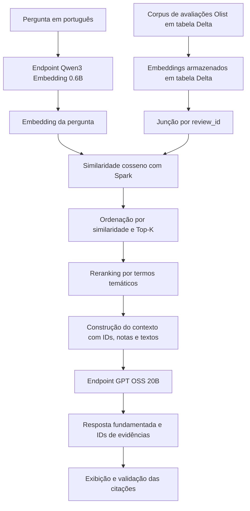

# Tech Challenge — Fase 4
## Voice of Customer Intelligence com Retrieval-Augmented Generation (RAG)


---

## 1. Contexto e problema de negócio

Empresas de comércio eletrônico recebem avaliações com elogios, reclamações e descrições de experiências de compra. Esses comentários contêm informações valiosas, mas a leitura individual de milhares de registros dificulta a identificação de padrões e a obtenção rápida de evidências.

A **Fase 4 do Tech Challenge** aborda esse problema por meio de uma solução de **Voice of Customer Intelligence**, utilizando avaliações textuais do conjunto **Brazilian E-Commerce Public Dataset by Olist** e a abordagem **Retrieval-Augmented Generation (RAG)**.

A proposta é permitir perguntas em linguagem natural sobre a experiência dos consumidores, recuperar comentários relacionados à pergunta e gerar respostas amparadas pelas avaliações encontradas — incluindo seus identificadores para rastreabilidade.

**Origem pública indicada pelo desafio:** [Brazilian E-Commerce Public Dataset by Olist — Kaggle](https://www.kaggle.com/datasets/olistbr/brazilian-ecommerce/data).

---

## 2. Objetivo da solução

Construir um fluxo que:

1. Receba uma pergunta sobre a experiência dos clientes.
2. Transforme a pergunta em um vetor (*embedding*).
3. Compare esse vetor com embeddings armazenados das avaliações.
4. Recupere documentos semanticamente semelhantes.
5. Reordene candidatos com regras temáticas (*reranking*).
6. Construa o contexto a partir das avaliações recuperadas.
7. Gere resposta em português usando um modelo de linguagem.
8. Apresente a resposta junto das evidências recuperadas e reconheça quando elas são insuficientes.

O projeto também contempla testes de perguntas, verificação de citações e avaliação automatizada do suporte das afirmações nas evidências.

---

## 3. Estrutura da Fase 4

| Arquivo | Responsabilidade |
|---|---|
| `Fase4_Olist_Preparacao.ipynb` | Diagnóstico de dependências e objetos, configuração dos endpoints, consulta a volume, definições e testes de funções RAG, além de validação das tabelas de corpus e embeddings. |
| `Fase4_Olist_Celula_Unica.ipynb` | Inicialização consolidada do RAG, busca vetorial, reranking, geração de respostas, evidências, testes, benchmark de nove perguntas, verificações de citações e avaliação automatizada. |

---

## 4. Arquitetura implementada



### 4.1. Serviços e armazenamento

| Componente | Uso identificado no código |
|---|---|
| Databricks | Ambiente de execução dos notebooks e acesso às tabelas. |
| PySpark / Apache Spark | Leitura, junção, cálculo vetorial e ordenação de documentos. |
| Delta Lake | Formato das tabelas consultadas no ambiente. |
| Databricks SDK — `WorkspaceClient` | Chamadas aos endpoints de modelos. |
| `databricks-qwen3-embedding-0-6b` | Geração do embedding da pergunta. |
| `databricks-gpt-oss-20b` | Geração de respostas e, no código de avaliação, análise automatizada de afirmações. |
| Pandas | Organização e exibição dos resultados de testes/benchmark. |
| Python (`json`, `re`, `unicodedata`, `traceback`) | Contexto, normalização de texto, expressões regulares e tratamento de erros. |

### 4.2. Tabelas utilizadas

```text
workspace.default.olist_rag_corpus
workspace.default.olist_rag_embeddings
```

A ligação entre elas ocorre pela coluna `review_id`.

O código de recuperação utiliza os seguintes campos das avaliações:

| Campo | Utilização |
|---|---|
| `review_id` | Identificação e rastreabilidade da avaliação. |
| `review_text` | Conteúdo textual recuperado. |
| `review_score` | Nota associada à avaliação. |
| `categorias_produtos` | Metadado de categorias. |
| `status_pedidos` | Metadado do pedido. |
| `atraso_medio_entrega_dias` | Metadado relacionado à entrega. |
| `embedding` | Vetor numérico usado na recuperação semântica. |

Os metadados acompanham as avaliações recuperadas. A recuperação é realizada por similaridade semântica e reranking temático.

---

## 5. Corpus e validação dos embeddings

O notebook `Fase4_Olist_Preparacao.ipynb` valida as tabelas de corpus e embeddings, incluindo contagens, IDs distintos, vetores inválidos e documentos sem embedding.

### 5.1. Resultado salvo da validação

| Verificação | Resultado |
|---|---:|
| Documentos no corpus | **42.370** |
| Embeddings armazenados | **42.370** |
| Embeddings com `review_id` distinto | **42.370** |
| Vetores nulos ou com dimensão diferente de 1.024 | **0** |
| Documentos do corpus sem embedding correspondente | **0** |

O próprio notebook registrou **`VALIDAÇÃO APROVADA!`**.

Os indicadores correspondem ao corpus utilizado no RAG, não ao volume total de registros da base original da Olist.

### 5.2. Como a integridade é verificada

A verificação contempla:

- Quantidade total de documentos na tabela de corpus.
- Quantidade total de registros na tabela de embeddings.
- Unicidade dos identificadores `review_id` nos embeddings.
- Presença de vetores nulos ou de dimensionalidade inesperada.
- Existência de documentos sem representação vetorial, por meio de `left_anti join`.

### 5.3. Organização da base de conhecimento

A solução consulta duas tabelas Delta: `olist_rag_corpus`, com os comentários e metadados, e `olist_rag_embeddings`, com as representações vetoriais vinculadas pelo campo `review_id`. O notebook de preparação executa as verificações de integridade necessárias para confirmar a correspondência entre os registros.

A operação descrita neste repositório parte dessas tabelas já populadas no workspace Databricks.

---

## 6. Pipeline de recuperação semântica

### 6.1. Embedding da pergunta

A função `buscar_avaliacoes(pergunta, k=10)` envia o texto da pergunta ao endpoint:

```python
EMBEDDING_ENDPOINT = "databricks-qwen3-embedding-0-6b"
```

O vetor devolvido é convertido para valores `float`. O código verifica que sua dimensão seja **1.024**; caso contrário, lança uma exceção.

### 6.2. Junção e cálculo da similaridade

O código consulta as duas tabelas do Databricks e as combina por `review_id`. Em seguida, associa o vetor da pergunta aos registros e calcula:

- Produto escalar entre os dois vetores.
- Norma do embedding armazenado.
- Norma do embedding da pergunta.
- **Similaridade cosseno**, calculada pela razão entre produto escalar e produto das normas, quando ambas são positivas.

A expressão é equivalente a:

\[
\operatorname{sim}(q,d) = \frac{q \cdot d}{\lVert q \rVert\lVert d \rVert}
\]

Os documentos são classificados por similaridade decrescente e a busca retorna até `k` registros.

### 6.3. Reranking

A função `reranquear_avaliacoes()` aplica regras temáticas à lista recuperada. O código contém palavras e expressões relacionadas, entre outros temas, a:

- Qualidade dos produtos.
- Atendimento e contato com a empresa.
- Elogios e experiências positivas.
- Entrega e atrasos.
- Comunicação sobre problemas de entrega.

Cada correspondência temática gera um bônus limitado, somado à similaridade original para produzir `score_reranking`.

A função `buscar_avaliacoes_reranqueadas(pergunta, k=5, candidatos=15)` busca inicialmente até **15 candidatos** e retorna até **5** após o reranking, por padrão.

**Justificativa técnica:** combinar proximidade semântica com sinais explícitos do tema da pergunta pode priorizar avaliações que mencionam diretamente o assunto investigado. Trata-se de um reranking baseado em regras, **não de um modelo de reranker treinado**.

---

## 7. Construção do contexto e geração da resposta

A função `responder_rag(pergunta, k=5)` organiza as avaliações selecionadas com:

```text
review_id
nota
texto
```

Esse conteúdo é serializado com `json.dumps(..., ensure_ascii=False)` e incluído no prompt enviado ao modelo:

```python
LLM_ENDPOINT = "databricks-gpt-oss-20b"
```

O prompt orienta o modelo a:

- Responder em português brasileiro e de forma objetiva.
- Utilizar apenas as avaliações recebidas como contexto.
- Sustentar afirmações com as avaliações e citar os IDs pertinentes.
- Evitar generalizar uma experiência individual para toda a base.
- Diferenciar problemas de entrega, qualidade e atendimento.
- Não inventar causas, acontecimentos ou conclusões.
- Declarar insuficiência de evidências quando os comentários não responderem à pergunta.

O endpoint é chamado com `temperature=0`. O código tenta gerar resposta com limites de **800** e, se necessário, **1.200 tokens**. A rotina também verifica respostas vazias, possíveis interrupções por limite de tokens e textos aparentemente truncados.

O retorno da função contém a resposta, as evidências recuperadas, o número de tentativas e um indicador de possível truncamento.

### 7.1. Exibição das evidências

A função `mostrar_resultado_rag()` exibe a resposta e, para os documentos recuperados, apresenta o `review_id`, a nota, o texto original e, quando disponível, as categorias dos produtos. Também mostra o número de tentativas de geração e o indicador de possível truncamento.

A existência de um documento na lista de evidências **não garante, por si só, que cada trecho da resposta seja sustentado por ele**; por esse motivo, o projeto inclui verificações adicionais de citações e avaliação semântica.

---

## 8. Tratamento de perguntas sem evidências

O código apresenta mecanismos de proteção contra respostas sem suporte:

1. Retorno específico quando nenhuma avaliação é recuperada.
2. Função `verificar_evidencia_especifica()` para uma pergunta particular sobre **atendimento telefônico aos domingos**, exigindo menções pertinentes no texto recuperado.
3. Instruções no prompt para o LLM declarar falta de evidências e não inventar respostas.
4. Testes com pergunta de evidência insuficiente e pergunta fora do escopo do conjunto de avaliações.

**Escopo do tratamento de evidências:** a verificação específica aplica regras para determinadas perguntas e é complementada por instruções de fundamentação no prompt. A busca vetorial retorna os resultados mais semelhantes disponíveis e a implementação não utiliza um limiar global calibrado de similaridade para descartar documentos de baixa relevância. Assim, a proteção contra respostas inadequadas depende também das instruções do modelo e dos testes realizados.

---

## 9. Testes, verificações e avaliação automatizada

O notebook `Fase4_Olist_Celula_Unica.ipynb` contém testes de perguntas, verificação de citações e um benchmark de nove questões.

### 9.1. Benchmark de perguntas

| ID | Tema | Pergunta | Classificação do teste |
|---:|---|---|---|
| 1 | Atendimento | Quais são as principais reclamações sobre o atendimento ao cliente? | Respondível |
| 2 | Qualidade | Quais problemas de qualidade dos produtos aparecem nas avaliações? | Respondível |
| 3 | Elogios | O que os clientes mais elogiam nas compras? | Respondível |
| 4 | Entrega | Quais problemas de entrega aparecem nas avaliações? | Respondível |
| 5 | Atrasos | Quais problemas os clientes relatam sobre atrasos na entrega? | Respondível |
| 6 | Comunicação | Quais problemas de comunicação aparecem quando ocorrem problemas na entrega? | Respondível |
| 7 | Experiência geral | Como os clientes avaliam a experiência geral de compra? | Respondível |
| 8 | Evidência insuficiente | O que os clientes dizem especificamente sobre o atendimento telefônico aos domingos? | Sem evidência específica |
| 9 | Fora do escopo | Qual será o faturamento da Olist no próximo ano? | Fora do escopo |

### 9.2. Verificação de citações

O código verifica se os IDs mencionados nas respostas estão entre os documentos recuperados. Os testes também registram casos de citações válidas e inválidas.

Além disso, há uma função de avaliação semântica que submete a resposta e suas evidências a um modelo de linguagem avaliador. A análise classifica afirmações quanto ao suporte nas avaliações e informa justificativas.

### 9.3. Resultados do benchmark

A seção de benchmark incluída no notebook registra:

| Indicador reportado | Resultado |
|---|---:|
| Perguntas submetidas | **9** |
| Perguntas aprovadas pelo avaliador automatizado | **9** |
| Aprovação no benchmark registrado | **100%** |
| Afirmações classificadas como sustentadas | **24** |
| Afirmações parcialmente sustentadas | **0** |
| Afirmações não sustentadas | **0** |
| Tentativas de geração registradas | **14** |
| Respostas que precisaram de segunda tentativa | **4** |
| Perguntas respondidas por abstenção, sem acionar o gerador | **1** |

Os resultados se referem ao conjunto de nove perguntas utilizado no benchmark e à classificação feita pelo avaliador automatizado.

### 9.4. Comparação da recuperação

A comparação reúne, para as perguntas do benchmark, documentos da **busca vetorial** e da **busca reranqueada**, incluindo posição, ID, similaridade, `score_reranking` e texto. Dessa forma, é possível inspecionar a ordenação dos documentos nos dois métodos.

---

## 10. Exemplos de uso registrados

### 10.1. Pergunta sobre atendimento

**Pergunta:** `Quais são as principais reclamações sobre o atendimento ao cliente?`

Uma execução salva apresenta resposta mencionando que consumidores reclamaram de canais sem resposta, atendimento telefônico ineficaz e dificuldade em obter retorno sobre cancelamentos e devoluções. A resposta incluiu identificadores das avaliações para sustentar as afirmações.

### 10.2. Pergunta sobre elogios

**Pergunta:** `O que os clientes mais elogiam nas compras?`

Uma execução salva destaca elogios à confiança e qualidade dos vendedores, ao atendimento, à rapidez da compra, à qualidade dos produtos e a entregas antecipadas, acompanhados de IDs de avaliações.

### 10.3. Ausência de evidências específicas

**Pergunta:** `O que os clientes dizem especificamente sobre o atendimento telefônico aos domingos?`

Esse caso está presente no benchmark para verificar a capacidade de abstenção quando as avaliações não oferecem evidências específicas sobre o assunto.

### 10.4. Pergunta fora do escopo

**Pergunta:** `Qual será o faturamento da Olist no próximo ano?`

A pergunta está incluída no benchmark para testar a reação da solução a uma previsão financeira que não pode ser sustentada apenas pelas avaliações de consumidores.

---

## 11. Tecnologias e bibliotecas

| Tecnologia / biblioteca | Finalidade |
|---|---|
| Databricks Notebooks | Ambiente de desenvolvimento e experimentação. |
| Python | Implementação das funções, regras e testes. |
| PySpark | Operações distribuídas sobre as tabelas e vetores. |
| Spark SQL | Expressões de agregação vetorial e consultas à estrutura de armazenamento. |
| Delta Lake | Tabelas do corpus e dos embeddings consultadas no Databricks. |
| Databricks SDK | `WorkspaceClient` e chamadas aos endpoints de serving. |
| Qwen3 Embedding 0.6B (endpoint Databricks) | Representação vetorial da pergunta. |
| GPT OSS 20B (endpoint Databricks) | Geração de respostas e avaliação automatizada. |
| Pandas | DataFrames de resumos, testes e resultados de benchmark. |
| JSON | Serialização do contexto e análise de saídas estruturadas. |
| `re` e `unicodedata` | Tratamento de texto e extração/normalização de informações. |

A recuperação vetorial é calculada diretamente em PySpark por similaridade cosseno.

---

## 12. Como executar

### 12.1. Pré-requisitos

- Workspace Databricks com execução de notebooks Python/Spark.
- Acesso às tabelas `workspace.default.olist_rag_corpus` e `workspace.default.olist_rag_embeddings`, já populadas.
- Acesso aos endpoints `databricks-qwen3-embedding-0-6b` e `databricks-gpt-oss-20b`.
- Bibliotecas usadas no código, especialmente `pyspark`, `databricks.sdk` e `pandas`.
- Permissões necessárias para consultar as tabelas e invocar os modelos.

### 12.2. Execução do núcleo do RAG

1. Abrir `Fase4_Olist_Celula_Unica.ipynb` no Databricks.
2. Conectar o notebook a um ambiente Spark configurado para acessar tabelas e endpoints.
3. Executar a célula inicial de **inicialização do RAG**, que define cliente, endpoints e funções.
4. Confirmar a mensagem `RAG inicializado com sucesso`.
5. Executar as células de demonstração, testes e benchmark na ordem das dependências internas.

Exemplo de chamada já presente na abordagem do projeto:

```python
pergunta = "Quais problemas os clientes relatam sobre atrasos na entrega?"
resultado = responder_rag(pergunta)
mostrar_resultado_rag(resultado)
```

O notebook também usa um widget Databricks (`dbutils.widgets.dropdown`) para selecionar uma pergunta de exemplo e apresentar o resultado.

### 12.3. Validação do armazenamento

No `Fase4_Olist_Preparacao.ipynb`, a célula de validação consulta as duas tabelas, conta documentos/embeddings e verifica vetores inválidos e pendências.

**Dependências de execução:** a execução requer acesso às tabelas Delta previamente populadas e aos dois endpoints configurados no ambiente Databricks.

---

## 13. Decisões técnicas

| Decisão / característica | Justificativa ou limite |
|---|---|
| Uso de embeddings | Permite recuperar avaliações por proximidade semântica com a pergunta. |
| Similaridade cosseno calculada em Spark | Estratégia implementada diretamente sobre vetores armazenados, sem índice vetorial dedicado demonstrado. |
| `review_id` como chave | Permite relacionar vetores a comentários e mostrar a origem da evidência. |
| Top-K antes da geração | Restringe a quantidade de avaliações analisadas pelo LLM. |
| Reranking por palavras temáticas | Prioriza menções relacionadas ao assunto da consulta; depende de regras e vocabulário definidos manualmente. |
| Prompt com regras de fundamentação | Orienta o modelo a não extrapolar as evidências. Não elimina integralmente alucinações. |
| Abstenção para casos sem evidência | Testada em situações específicas; não há filtro genérico calibrado por limiar de similaridade. |
| Duas tentativas de geração | Recuperação em caso de saída vazia ou possivelmente incompleta. |
| Avaliação automatizada de afirmações | Fornece feedback de suporte e citações, mas não substitui auditoria humana. |
| Corpus persistido em Delta | Permite consultar, relacionar e validar avaliações e embeddings por `review_id`. |

---

## 14. Organização do fluxo de execução

O fluxo principal da Fase 4 está concentrado nos notebooks `Fase4_Olist_Preparacao.ipynb` e `Fase4_Olist_Celula_Unica.ipynb`. O primeiro reúne diagnósticos e validações do armazenamento; o segundo contém as funções de recuperação, reranking, geração, exibição de evidências e testes.

O uso pressupõe as tabelas `olist_rag_corpus` e `olist_rag_embeddings` disponíveis no Databricks, bem como permissão para invocar os endpoints dos modelos.

---

## 15. Rastreabilidade dos requisitos da Fase 4

A tabela relaciona os principais componentes do pipeline aos notebooks e funções correspondentes, facilitando a navegação pelo código e pelos resultados de execução.

| Requisito / etapa | Notebook | Implementação / resultado | Status |
|---|---|---|---|
| Base de conhecimento Olist | [`Fase4_Olist_Preparacao.ipynb`](Fase4_Olist_Preparacao.ipynb) | Consulta e validação de `workspace.default.olist_rag_corpus` (42.370 documentos registrados) | **Validado** |
| Integridade dos embeddings | [`Fase4_Olist_Preparacao.ipynb`](Fase4_Olist_Preparacao.ipynb) | Contagem, IDs distintos, dimensão 1.024, vetores inválidos e documentos sem embedding | **Validado** |
| Configuração dos endpoints | [`Fase4_Olist_Celula_Unica.ipynb`](Fase4_Olist_Celula_Unica.ipynb) | `EMBEDDING_ENDPOINT`, `LLM_ENDPOINT` e `WorkspaceClient` | **Implementado** |
| Transformação da pergunta em vetor | [`Fase4_Olist_Celula_Unica.ipynb`](Fase4_Olist_Celula_Unica.ipynb) | `buscar_avaliacoes()` consulta o endpoint de embeddings | **Implementado** |
| Recuperação semântica | [`Fase4_Olist_Celula_Unica.ipynb`](Fase4_Olist_Celula_Unica.ipynb) | Junção por `review_id`, cálculo de similaridade cosseno e ordenação Top-K em PySpark | **Implementado** |
| Reranking temático | [`Fase4_Olist_Celula_Unica.ipynb`](Fase4_Olist_Celula_Unica.ipynb) | `reranquear_avaliacoes()` e `buscar_avaliacoes_reranqueadas()` | **Implementado** |
| Construção do contexto e geração da resposta | [`Fase4_Olist_Celula_Unica.ipynb`](Fase4_Olist_Celula_Unica.ipynb) | `responder_rag()` organiza ID, nota e texto das avaliações e chama o LLM | **Implementado** |
| Evidências e rastreabilidade das afirmações | [`Fase4_Olist_Celula_Unica.ipynb`](Fase4_Olist_Celula_Unica.ipynb) | `mostrar_resultado_rag()`, `verificar_citacoes()` e `avaliar_precisao_citacoes()` | **Implementado e testado** |
| Tratamento de perguntas sem evidência ou fora do escopo | [`Fase4_Olist_Celula_Unica.ipynb`](Fase4_Olist_Celula_Unica.ipynb) | `verificar_evidencia_especifica()`, instruções do prompt e perguntas de teste | **Testado em casos específicos** |
| Testes de qualidade das respostas | [`Fase4_Olist_Celula_Unica.ipynb`](Fase4_Olist_Celula_Unica.ipynb) | `avaliar_resposta_rag()` e benchmark registrado de nove perguntas | **Executado** |
| Comparação de documentos antes e depois do reranking | [`Fase4_Olist_Celula_Unica.ipynb`](Fase4_Olist_Celula_Unica.ipynb) | Células que exibem resultados da busca vetorial e da busca reranqueada | **Demonstrado** |

Os links dos notebooks consideram os arquivos `.ipynb` na mesma pasta deste README.

---

## 16. Conclusão

O projeto implementa uma solução de *Voice of Customer Intelligence* com recuperação semântica de avaliações, reranking temático, geração de respostas por LLM e exibição de evidências identificáveis.

Na validação do ambiente, o corpus e os embeddings foram validados com **42.370 documentos**, **42.370 vetores únicos**, **nenhum vetor inválido** e **nenhum documento sem embedding**. O benchmark realizado de nove perguntas registra aprovação das respostas por um **avaliador automatizado**, incluindo casos de insuficiência de evidências e consultas fora do escopo.

A solução contempla as principais etapas de um pipeline RAG: representação vetorial, recuperação semântica, reranking, construção de contexto, geração e verificação de evidências. Sua execução utiliza tabelas e endpoints configurados no Databricks.

---

## Referências

- [Brazilian E-Commerce Public Dataset by Olist — Kaggle](https://www.kaggle.com/datasets/olistbr/brazilian-ecommerce/data)
- Enunciado **Tech Challenge — Fase 4: Voice of Customer Intelligence com RAG** (FIAP / POSTECH).
- Notebooks do próprio projeto: `Fase4_Olist_Preparacao.ipynb` e `Fase4_Olist_Celula_Unica.ipynb`.
